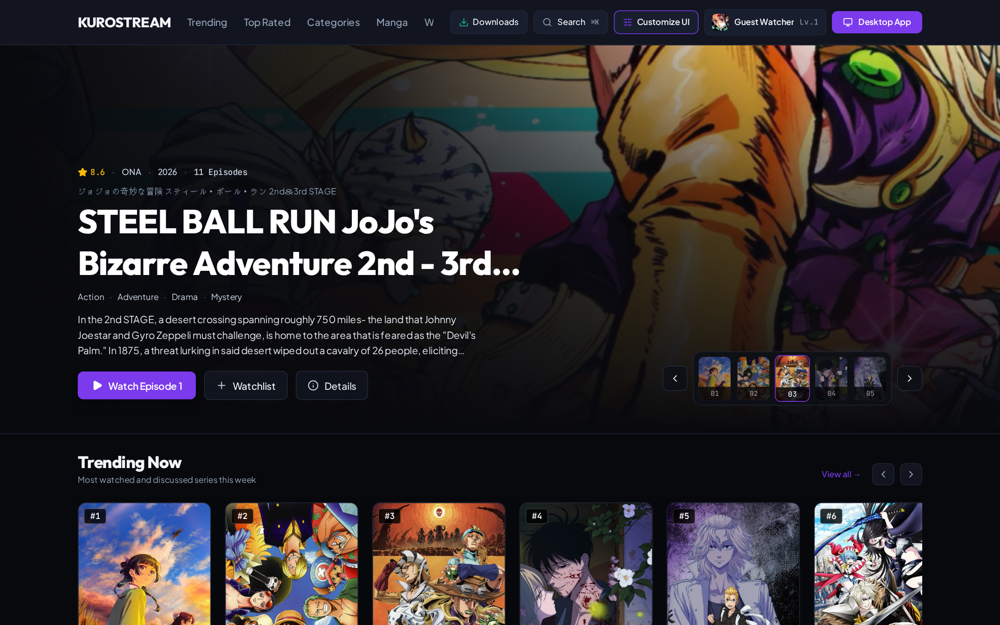
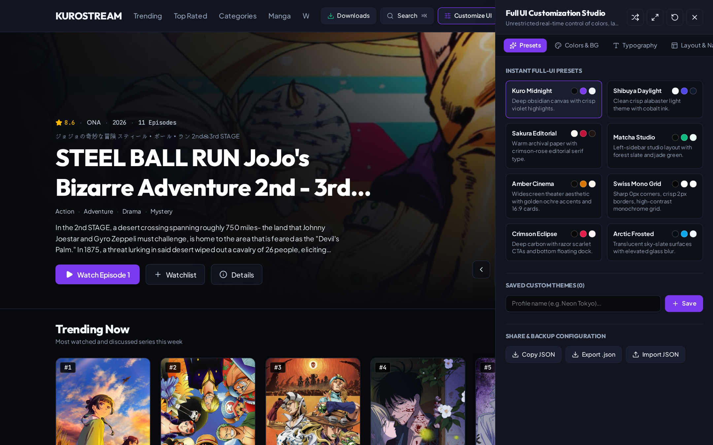
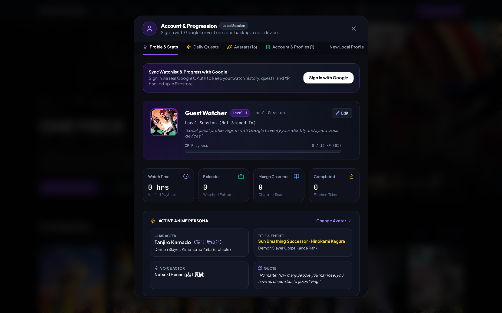
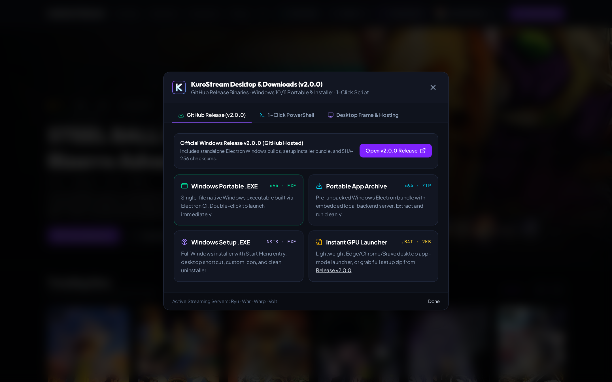

<div align="center">



<br />

# KuroStream

**Full-Stack Anime Streaming · Manga Reader · Watch Parties · Zero-Limits UI Customizer · Windows Desktop Edition**

[](https://github.com/hitesh231219-eng/kurostream/releases/tag/v2.0.0)
[](https://github.com/hitesh231219-eng/kurostream/actions/workflows/ci.yml)
[](https://github.com/hitesh231219-eng/kurostream/actions/workflows/release-windows.yml)
[](https://hitesh231219-eng.github.io/kurostream/)
[](https://github.com/hitesh231219-eng/kurostream/releases)
[](LICENSE)

[**Download Windows v2.0.0**](https://github.com/hitesh231219-eng/kurostream/releases/tag/v2.0.0) · [**Launch Web App**](https://kurostream-app.netlify.app) · [**Live Full-API Mirror**](https://kurostream-m1.vercel.app) · [**Static GitHub Pages**](https://hitesh231219-eng.github.io/kurostream/) · [**Changelog**](CHANGELOG.md)

</div>

---

## Windows Desktop Downloads (`v2.0.0` Stable)

Grab the official desktop edition directly from [**GitHub Releases `v2.0.0`**](https://github.com/hitesh231219-eng/kurostream/releases/tag/v2.0.0) — built with an embedded Express backend and zero third-party file host expiration.

| Package | Format | Architecture | What's Included | Download |
| :--- | :--- | :--- | :--- | :--- |
| **KuroStream Portable (.EXE)** | Single Executable | `Windows x64` | Native standalone Electron binary — run from any folder or USB drive | [**Download .EXE**](https://github.com/hitesh231219-eng/kurostream/releases/download/v2.0.0/KuroStream-Portable-2.0.0-x64.exe) |
| **KuroStream Setup (.EXE)** | NSIS Installer | `Windows x64` | Desktop shortcut, Start Menu integration, custom `.ico`, clean uninstaller | [**Download Installer**](https://github.com/hitesh231219-eng/kurostream/releases/download/v2.0.0/KuroStream-Setup-2.0.0-x64.exe) |
| **KuroStream Portable Archive (.ZIP)** | Unpacked Bundle | `Windows x64` | Immediate extract-and-run Electron runtime + embedded Node server | [**Download Portable .ZIP**](https://github.com/hitesh231219-eng/kurostream/releases/download/v2.0.0/KuroStream-Portable-2.0.0-x64.zip) |
| **Windows Installer Kit (.ZIP)** | Script + Assets | `Win 10 / 11` | Inno Setup `installer.iss`, PowerShell installer, silent GPU launcher `.bat` | [**Download Setup Kit**](https://github.com/hitesh231219-eng/kurostream/releases/download/v2.0.0/KuroStream-Windows-Setup-Package.zip) |

### 1-Click PowerShell Setup (No Admin Required)

```powershell
irm "https://kurostream-app.netlify.app/install-kurostream.ps1" | iex
```

---

## Real Application Screenshots

<table>
  <tr>
    <td width="50%" align="center">
      
      <br />
      <strong>Live Hero &amp; Trending Catalog</strong> — Real-time AniList GraphQL carousels, quick watchlist actions, and responsive cards.
    </td>
    <td width="50%" align="center">
      
      <br />
      <strong>Zero-Limits UI Customizer (<code>Ctrl+,</code>)</strong> — 8 instant presets, custom hex palettes, wallpapers, fonts, nav shells, and live CSS.
    </td>
  </tr>
  <tr>
    <td width="50%" align="center">
      
      <br />
      <strong>Series Details, Cast &amp; Downloads</strong> — Countdown metadata, character voice cast, recommendations, and verified download resolver.
    </td>
    <td width="50%" align="center">
      
      <br />
      <strong>Desktop &amp; Downloads Hub (<code>v2.0.0</code>)</strong> — Direct GitHub Release <code>.EXE</code> &amp; <code>.ZIP</code> downloads, PowerShell installer, and desktop frame toggle.
    </td>
  </tr>
</table>

---

## Core Capabilities

| Module | Highlights |
| :--- | :--- |
| **Zero-Limits UI Customizer** (`Ctrl+,`) | Unrestricted light/dark schemes, arbitrary hex palettes, 3-stop gradients, custom wallpaper URLs + blur/dimmer controls, any Google Font, top/sidebar/bottom-dock/hidden navigation layouts, `Full`/`Compact`/`Split`/`Minimal`/`Hidden` hero modes, 2–8 column grids, home section reorder/rename/hide, profile presets, JSON export/import, and live raw CSS injection. |
| **Verified Download Engine** | Real identity-matched AniList / MyAnimeList / AniDB resolution across **NekoStream Pahe -> Kwik**, **AnimeTosho**, **Nyaa**, **NekoBT**, **AniDex**, and **SubsPlease** with live health probes and direct container links. |
| **Multi-Server Anime & Manga** | Parallel streaming servers (`Ryu`, `War`, `Warp`, `Volt`) with automated fallback, plus verified chapter reader (`Honey`, `Sol`) backed by SSRF-hardened proxying. |
| **Live WebSocket Watch Parties** | Room-scoped synchronized playback, drift correction, host authority controls, and real-time chat. |
| **Windows Desktop Frame & Tray** | Frameless native Windows 11-style controls, standalone embedded Express API on dynamic localhost port, and protocol handler (`kurostream://`). |
| **Cloud Sync & Mirror Matrix** | Optional Firebase Authentication + Cloud Firestore watchlist/history persistence paired with local failover and 11 live Netlify & Vercel deployment mirrors. |

---

## Official Deployment Mirrors

| Role | Provider | Endpoint | Capabilities |
| :--- | :--- | :--- | :--- |
| **Primary Origin** | Netlify | https://kurostream-app.netlify.app | Full SPA + Serverless API + Installers |
| **Primary Vercel** | Vercel | https://kurostream-m1.vercel.app | Full SPA + `/api/*` Proxy Routes |
| **Vercel Cluster** | Vercel | `kurostream-m2` – `kurostream-m5.vercel.app` | Regional Mirror Cluster |
| **Netlify Cluster** | Netlify | `kurostream-m1` – `kurostream-m5.netlify.app` | Redundant Mirror Cluster |
| **Static Mirror** | GitHub Pages | https://hitesh231219-eng.github.io/kurostream/ | Static SPA Showcase |

---

## System Architecture

```
┌──────────────────────────────────────────────────────────────────────────┐
│                         KUROSTREAM CLIENT (React 19)                     │
│  UI Customizer Engine · Player · Manga Reader · Watch Party · Wizard     │
└───────────────┬─────────────────────────────────────────┬────────────────┘
                │ /api/* + WebSockets                     │ GraphQL / Auth
                ▼                                         ▼
┌───────────────────────────────┐         ┌────────────────────────────────┐
│   EMBEDDED / CLOUD BACKEND    │         │       EXTERNAL PROVIDERS       │
│  Express Server & Proxy Hub   │         │  AniList · Jikan · Firebase    │
│  Pahe/Kwik · AnimeTosho · RSS │         │  Ryu · War · Warp · Volt       │
└───────────────┬───────────────┘         └────────────────────────────────┘
                │ Packaged Together
                ▼
┌──────────────────────────────────────────────────────────────────────────┐
│                 WINDOWS ELECTRON RUNTIME (v2.0.0 x64)                    │
│   Portable Executable (.EXE) · NSIS Installer (.EXE) · Portable (.ZIP)   │
└──────────────────────────────────────────────────────────────────────────┘
```

---

## Development & Self-Hosting

### Prerequisites

- **Node.js** `20+` (CI verified on Node `22`)
- **npm** `10+`

### Run Locally

```bash
git clone https://github.com/hitesh231219-eng/kurostream.git
cd kurostream
npm install
cp .env.example .env   # Windows CMD: copy .env.example .env (or run: npm run setup)
npm run dev
```

### All Available Commands (Windows, macOS & Linux)

| Command | Purpose |
| :--- | :--- |
| `npm run setup` | Cross-platform `.env` initialization from `.env.example` |
| `npm run dev` | Start full-stack Express + Vite + WebSocket dev server on port `3000` |
| `npm run verify` | Run `lint`, `test`, `build`, and `build:electron-server` together |
| `npm run lint` | Strict TypeScript typecheck (`tsc --noEmit`) |
| `npm test` | Run all Vitest unit & integration suites (`npm run test:watch` for watch mode) |
| `npm run build` | Build production Vite frontend bundle into `dist/` |
| `npm run build:electron-server` | Bundle embedded Express desktop server into `electron/embedded-server.cjs` |
| `npm start` | Start production Express + WebSocket server (`--prod`) |
| `npm run preview` | Preview built `dist/` frontend on port `3000` |
| `npm run clean` | Cross-platform clean of `dist/`, `dist-electron/`, and compiled artifacts |
| `npm run electron:start` | Build web + embedded server and launch Electron desktop client locally |
| `npm run build:win` | Build both Windows Portable `.exe` and NSIS Setup `.exe` installers |
| `npm run build:win-portable` | Build single-file Windows Portable `.exe` only |

---

## Release History & Contributions

- Review full release notes in [**CHANGELOG.md**](CHANGELOG.md).
- Read setup and contribution guidelines in [**CONTRIBUTING.md**](CONTRIBUTING.md).
- Report bugs or request features using the templates in [`.github/ISSUE_TEMPLATE`](.github/ISSUE_TEMPLATE).
- Pull requests and pushes are automatically checked by [CI — Test, Lint & Build](https://github.com/hitesh231219-eng/kurostream/actions/workflows/ci.yml).

## License

Released under the [MIT License](LICENSE).
